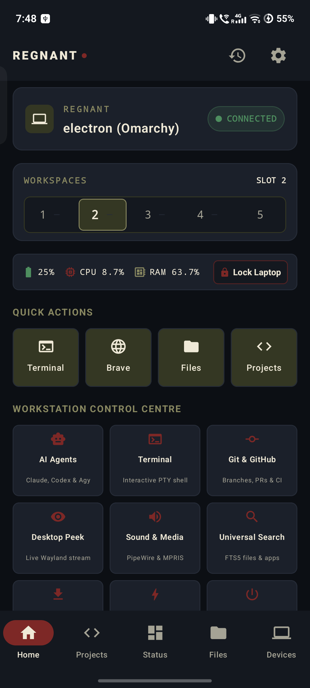
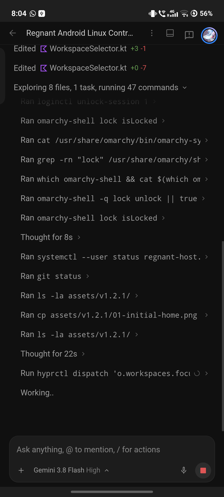
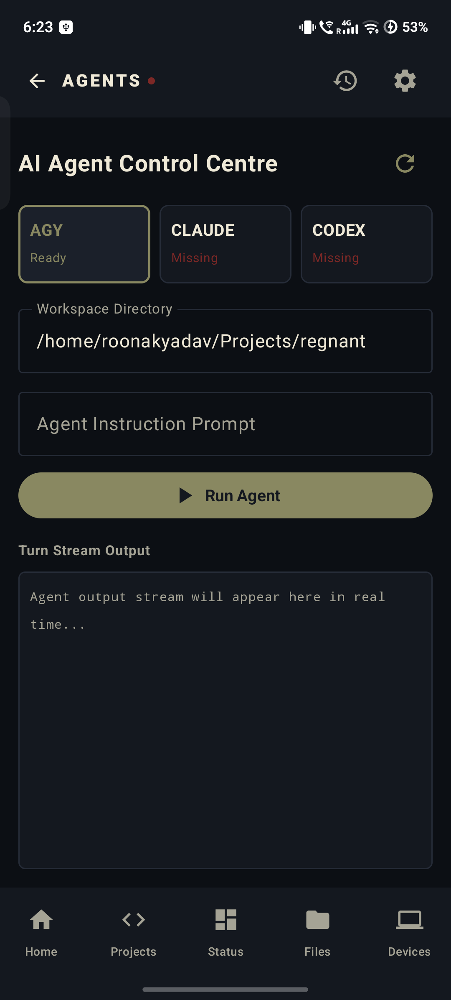
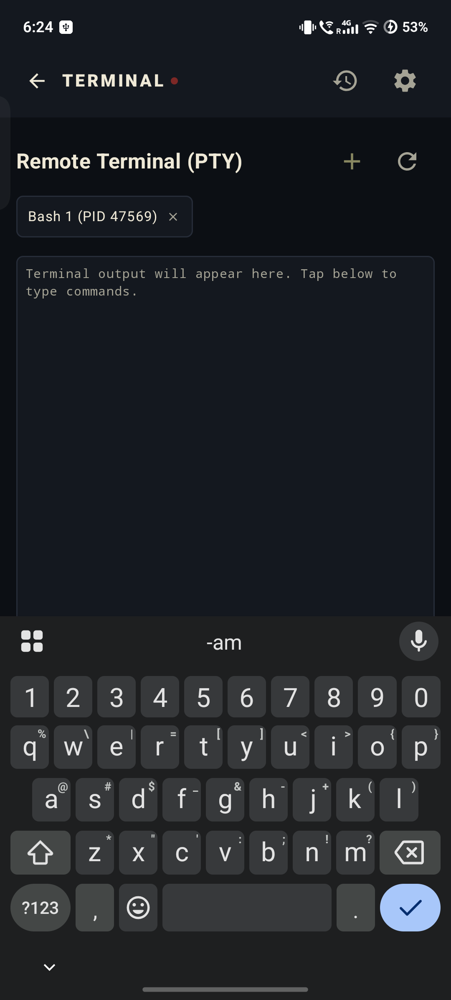
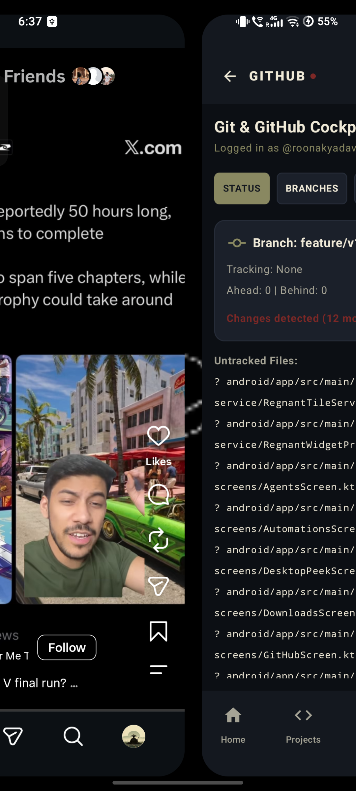
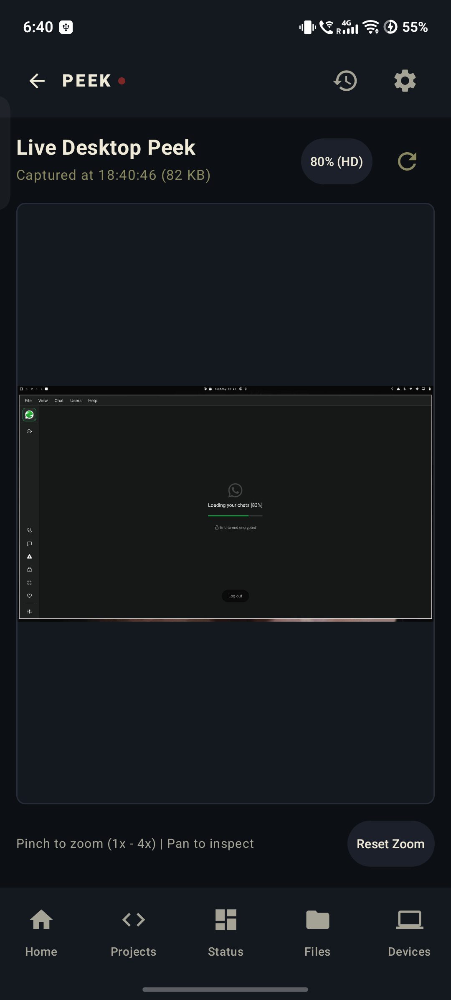
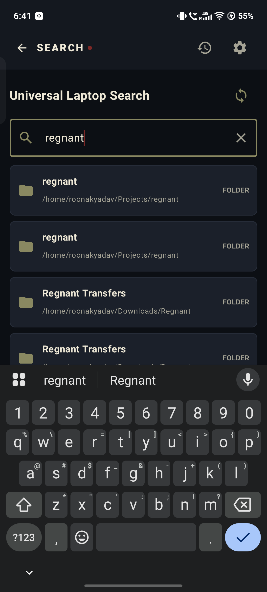
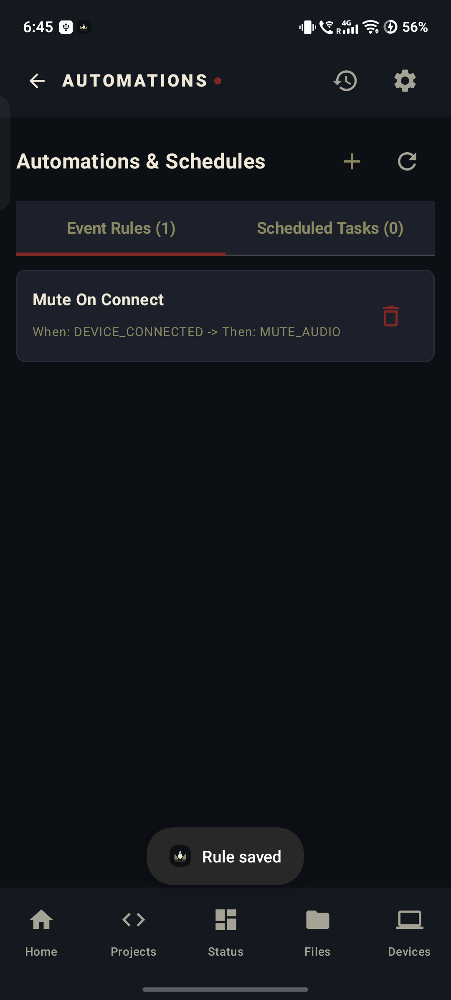
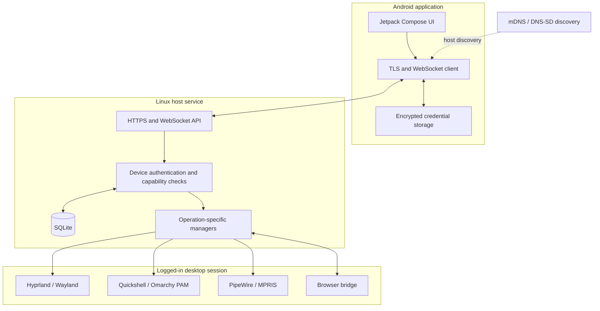

<div align="center">


# Regnant

### An Android control plane for your Linux desktop.

Control workspaces, developer tools and selected desktop operations from your phone over your local network.

[Architecture](docs/ARCHITECTURE.md) · [Installation](docs/INSTALLATION.md) · [Security](docs/SECURITY.md) · [Contributing](CONTRIBUTING.md) · [Known limitations](docs/KNOWN_LIMITATIONS.md)


</div>

---

## Overview

Regnant pairs an Android application with a user-session service on a Linux workstation. The phone becomes a remote control surface for selected system operations and developer workflows.

The design is **local-first**: the normal control path uses a direct local-network connection between the phone and laptop. Regnant does not require an AI API key or a cloud relay for its core control path.

The strongest current integration target is **Omarchy Linux with Hyprland and Wayland**. Some features depend on the desktop session and tools installed on the host.

## Screenshots

The following screenshots are captured from the running Android application.

| Home and device status | Workspace selector |
|---|---|
|  |  |

| Developer control centre | Persistent terminal |
|---|---|
|  |  |

| Git cockpit | Desktop peek |
|---|---|
|  |  |

| Search | Automations |
|---|---|
|  |  |

## Current capabilities

Capabilities below reflect modules present in the current codebase. Their deployment requirements and verification boundaries are described in [Known limitations](docs/KNOWN_LIMITATIONS.md).

| Area | Capability |
|---|---|
| Connection | Manual code pairing, host discovery, authenticated local connection and reconnection |
| Workstation | Live system telemetry, project launcher and Hyprland workspace switching |
| Lock screen | Lock and Omarchy PAM-backed remote unlock |
| Files | Read-only file browsing and text preview; transfer support exists in the host implementation |
| Developer tools | Persistent terminal sessions, agent adapter discovery, Git status and GitHub integration |
| Desktop | Window/workspace operations, desktop capture and browser bridge components |
| Media | PipeWire volume and MPRIS media controls |
| Utility | Host search, Downloads-directory inspection, automation rules and Wake-on-LAN packet sending |

Not every listed capability has been verified end-to-end on every supported environment. For example, agent adapters' presence does not mean every CLI's interactive task streaming has been proven, and Wake-on-LAN success depends on firmware and network configuration.

## Architecture



Editable Mermaid sources are in [docs/diagrams](docs/ARCHITECTURE.md#diagrams).

## How it works

1. Start the Linux host service in the logged-in user session.
2. Display or retrieve the short-lived pairing code from the host.
3. Enter the code in the Android app.
4. The client stores its pairing material and host identity using Android encrypted storage.
5. Subsequent API and WebSocket requests use TLS with host certificate pinning and a paired-device bearer token.
6. The host checks the device and requested capability before dispatching an operation to its manager.

See [pairing and authentication diagram](docs/diagrams/pairing-and-authentication.mmd) and [security model](docs/SECURITY.md).

## Requirements

### Android

- Android 10 (API 29) or later.
- Android Studio or command-line Android SDK for development.
- JDK 21 for Gradle builds.

### Linux host

- Linux desktop session; the best-tested target is Omarchy with Hyprland and Wayland.
- Node.js 26 and npm.
- User-session access to the desktop utilities required by the features being used.
- Avahi/mDNS support for network discovery, where available.
- Additional optional tools for specific integrations, such as `hyprctl`, `grim`, `wpctl`, `busctl`, `wl-copy` and `wl-paste`.

Some capabilities are Omarchy/Quickshell-specific. Review [installation requirements](docs/INSTALLATION.md) before using the application.

## Installation

The detailed guide is in [docs/INSTALLATION.md](docs/INSTALLATION.md).

Quick host setup:

```bash
git clone https://github.com/axonel/regnant.git
cd regnant
bash linux/scripts/install.sh
```

The installer creates a user-level systemd service and a desktop launcher. It assumes the host environment and tools documented in the installation guide.

Build the Android debug APK:

```bash
cd android
./gradlew assembleDebug
```

The APK is generated at `android/app/build/outputs/apk/debug/app-debug.apk`.

## Development

See [DEVELOPMENT.md](docs/DEVELOPMENT.md) for the toolchain and contribution workflow.

Linux host tests:

```bash
cd linux/host
npm ci
npm test
```

Android build and test task:

```bash
cd android
./gradlew testDebugUnitTest assembleDebug
```

At the time of this repository preparation, the host suite reports **34 passing tests**. The Android Gradle test task reports `NO-SOURCE`, meaning no Android unit tests are currently defined. See [development guide](docs/DEVELOPMENT.md).

## Repository layout

```text
regnant/
├── android/                  # Native Android app (Kotlin / Compose)
├── linux/
│   ├── host/                 # Node.js host service and tests
│   ├── desktop/              # Electron desktop companion
│   ├── browser-extension/    # Chromium Manifest V3 extension
│   ├── omarchy/              # Omarchy integration patch
│   └── scripts/              # Host installer and uninstaller
├── shared/                   # Shared protocol definitions
├── assets/                   # App icons and genuine UI screenshots
├── docs/                     # Architecture, security and operator guides
└── .github/                  # CI, issue templates and PR template
```

## Security

Regnant exposes workstation operations to paired devices. Treat pairing credentials as sensitive and do not expose the host service to untrusted networks.

Important notes:
- Local-network membership is not authentication.
- Host capabilities and paired-device revocation are enforced by the host.
- Remote unlock delegates to Omarchy's PAM flow; the login password is transmitted over the authenticated local TLS connection and exists transiently in memory.
- The browser extension requests broad website host permissions. Review the manifest before enabling it in a sensitive browser profile.
- This project has not undergone an independent security audit.

Read [SECURITY.md](SECURITY.md) and [docs/SECURITY.md](docs/SECURITY.md) before deployment. Report vulnerabilities privately through GitHub's Security tab.

## Known limitations

- The strongest integration target is Omarchy / Hyprland / Wayland, not every Linux desktop environment.
- Android background connectivity can be affected by OEM battery management.
- Wi-Fi client isolation can prevent peer-to-peer connectivity.
- Browser extension installation and live browser control require manual setup.
- Wake-on-LAN requires compatible firmware, NIC and network configuration.
- Some subsystems have automated unit coverage but need further physical-device and real-environment acceptance testing.

See [the full limitations list](docs/KNOWN_LIMITATIONS.md).

## Contributing

Contributions are welcome. Start with [CONTRIBUTING.md](CONTRIBUTING.md), read the architecture and security notes, and open a focused pull request.

## Roadmap

The roadmap is maintained through GitHub issues and discussions. Please check existing proposals before starting a substantial feature.

## License

Regnant is distributed under the [MIT License](LICENSE).
