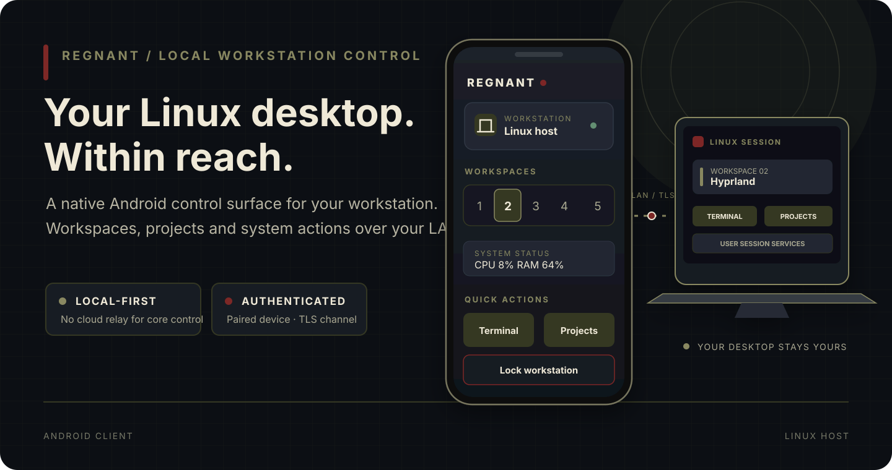
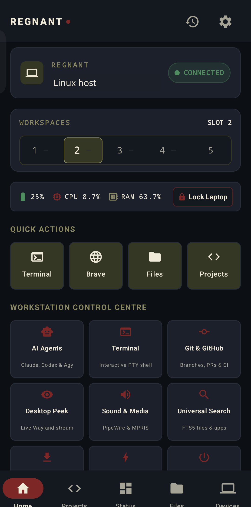
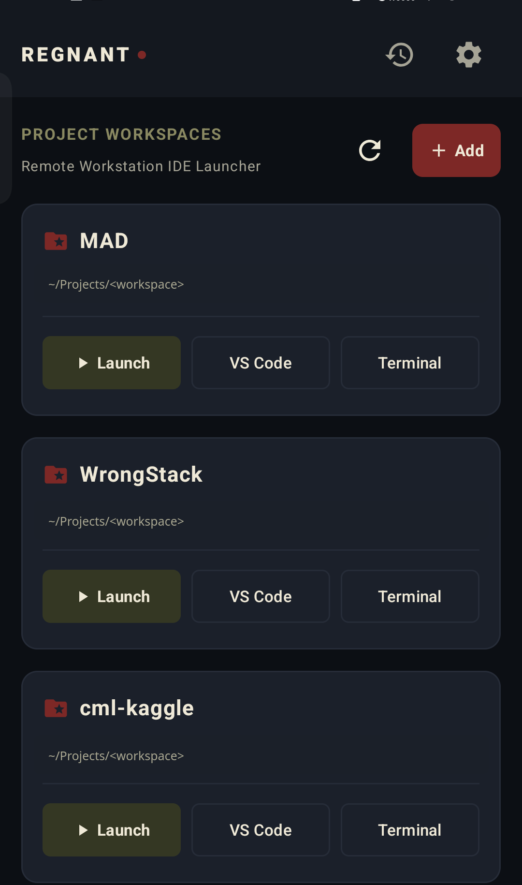
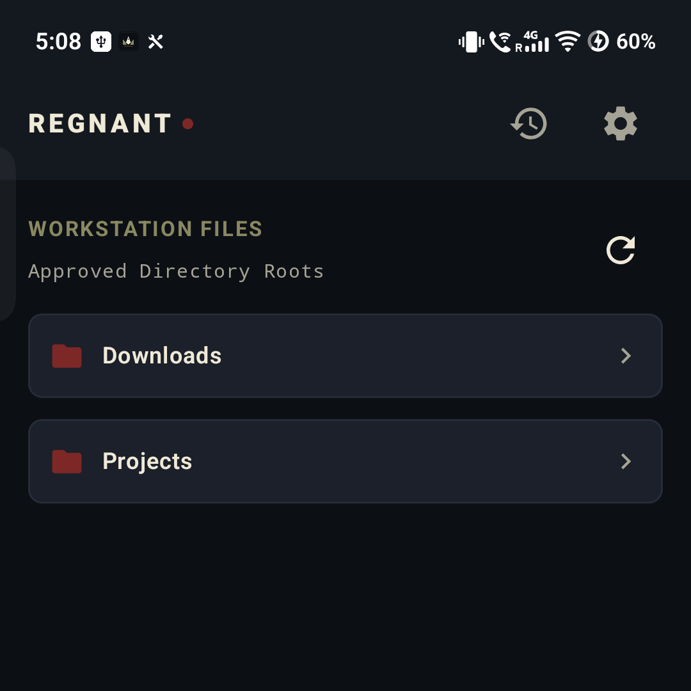
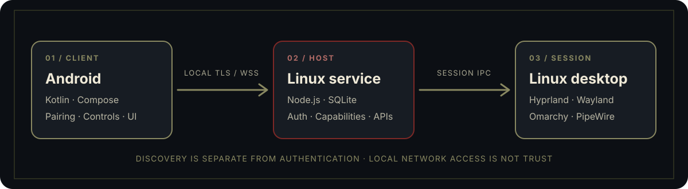

  
  <h1>Regnant</h1>
  
<strong>Your Linux desktop. Within reach.</strong>

  
A native Android control surface for your Linux workstation — connected directly over your local network.

  

    <a href="docs/INSTALLATION.md">Install</a> ·
    <a href="docs/ARCHITECTURE.md">Architecture</a> ·
    <a href="docs/SECURITY.md">Security</a> ·
    <a href="CONTRIBUTING.md">Contribute</a>
  

  

    
    
    
    
    
    
    
  

  
  Product illustration. The interface captures below are from the running Android app.

---

## A control surface, not a remote desktop

Regnant pairs an Android app with a user-session service on your Linux machine. Your phone becomes a compact control surface for the things you reach for repeatedly: workspaces, projects, system status, and selected desktop operations.

The core control path runs directly over your LAN. It does not need a hosted relay or an AI API key. Pair the phone with the host, then issue authenticated commands over the local connection.

**The primary integration target is Omarchy Linux with Hyprland and Wayland.** Some capabilities depend on the desktop session and the tools installed on the host; this is not a promise of universal support across every Linux distribution.

## What it looks like

<table border="0" cellspacing="0" cellpadding="12">
  <tr>
    <td width="38%" valign="middle">
      
    </td>
    <td valign="middle">
      <h3>Control the workstation at a glance</h3>
      See whether the host is connected, check live system metrics, and switch between the first five Hyprland workspace slots without reaching for the laptop. Common actions stay on the home screen.
    </td>
  </tr>
  <tr>
    <td valign="middle">
      <h3>Jump straight into a project</h3>
      Keep frequently used project directories in one launcher. Open a project, start its supported IDE, or open a terminal in its workspace.
    </td>
    <td width="38%" valign="middle">
      
    </td>
  </tr>
  <tr>
    <td width="38%" valign="middle">
      
    </td>
    <td valign="middle">
      <h3>Browse only approved locations</h3>
      Navigate host directories that have been explicitly approved and preview supported text files. Regnant does not expose the entire filesystem by default.
    </td>
  </tr>
</table>

## What you can control

| Area | Included capabilities |
|---|---|
| **Workstation** | Connection state, hardware telemetry, Hyprland workspace switching, project launcher |
| **Session** | Lock the workstation; Omarchy-specific PAM-backed remote unlock |
| **Developer workflow** | Persistent terminal sessions, local Git controls, optional GitHub CLI integration, installed-agent adapters |
| **Desktop utilities** | Approved file browsing, PipeWire volume and MPRIS controls, local search |
| **Automation** | Saved rules and scheduled actions, Wake-on-LAN packet sending |
| **Browser** | Chromium Manifest V3 companion and local browser bridge |

This is an implementation inventory, not a claim that every integration is equally portable or fully verified on every machine. For the exact scope and verification boundaries, see the [feature inventory](docs/FEATURES.md) and [known limitations](docs/KNOWN_LIMITATIONS.md).

## How it is put together

The Android client discovers and pairs with the host. After pairing, requests travel over the authenticated TLS/WebSocket channel. The host checks the device and requested capability before dispatching an operation into the logged-in desktop session.

  

| Component | Implementation |
|---|---|
| Android client | Kotlin, Jetpack Compose, OkHttp, Android network service discovery |
| Linux host | Node.js, HTTPS/WSS API, SQLite, operation-specific managers |
| Desktop integration | Hyprland IPC, Wayland utilities, Quickshell/Omarchy, PipeWire/MPRIS |
| Browser companion | Chromium Manifest V3 extension and local bridge |

The editable architecture, pairing, command-flow, lifecycle and security diagrams are in the [architecture documentation](docs/ARCHITECTURE.md#diagrams).

## Get started

### Requirements

- **Android:** Android 10 (API 29) or newer.
- **Linux host:** Node.js 26, npm and a systemd user session.
- **Best-supported desktop:** Omarchy with Hyprland and Wayland.
- **Network:** the phone and laptop must be able to reach each other on the local network.

Some optional features also need host utilities such as <code>hyprctl</code>, <code>grim</code>, <code>wpctl</code>, <code>busctl</code>, <code>wl-copy</code>, <code>wl-paste</code>, or Omarchy/Quickshell components.

### Install the Linux host

The current installer is oriented toward the Omarchy development environment. Review [linux/scripts/install.sh](linux/scripts/install.sh) before running it, especially on another distribution.

~~~bash
git clone https://github.com/axonel/regnant.git
cd regnant
bash linux/scripts/install.sh
~~~

Check the user service:

~~~bash
systemctl --user status regnant-host.service
journalctl --user -u regnant-host.service -f
~~~

### Build the Android app

Install JDK 21 and Android SDK API 36, then build the debug APK:

~~~bash
cd android
./gradlew assembleDebug
~~~

The APK is created at:

~~~text
android/app/build/outputs/apk/debug/app-debug.apk
~~~

### Pair your phone

1. Start the Linux host service.
2. Open the host-side Regnant interface and obtain its short-lived pairing code.
3. Select the host in the Android app and enter the code.
4. Confirm that the connection is established before sending commands.

Pairing codes are short-lived and single-use. Do not share them or include them in screenshots or issue reports.

For the full setup, troubleshooting and uninstall steps, read the [installation guide](docs/INSTALLATION.md).

## Security and platform boundaries

Regnant can control consequential operations on a personal workstation. Its security model includes paired-device authentication, TLS transport, host certificate pinning, per-device capabilities and revocation. Local-network membership alone is not treated as authentication.

A few boundaries matter:

- Desktop operations run with the logged-in user's privileges.
- Remote unlock is specific to Omarchy's Quickshell/PAM integration. The Linux login password is sent to the host over the authenticated TLS connection for PAM validation; it is not intentionally persisted by the app, but exists transiently in process memory and transport buffers.
- Audio controls depend on PipeWire/WirePlumber and MPRIS. Desktop capture depends on a supported Wayland capture path.
- Android background behaviour is subject to Android and device-manufacturer battery policies.
- The browser extension requires manual installation and requests broad website host permissions.
- Regnant has not undergone an independent security audit.

Read the full [security model](docs/SECURITY.md) and [known limitations](docs/KNOWN_LIMITATIONS.md) before enabling remote control on a machine containing sensitive data. Report vulnerabilities privately through the repository's Security tab.

## Development and tests

Linux host:

~~~bash
cd linux/host
npm ci
npm test
~~~

Android:

~~~bash
cd android
./gradlew testDebugUnitTest assembleDebug
~~~

The Linux host suite currently has **34 passing tests**. The Android Gradle test task currently reports <code>NO-SOURCE</code>: the project does not yet contain Android unit-test source files. The Android debug APK build is verified in CI.

See the [development guide](docs/DEVELOPMENT.md) and [contribution guidelines](CONTRIBUTING.md) before opening a pull request.

## Project documentation

- [Architecture](docs/ARCHITECTURE.md)
- [Feature inventory](docs/FEATURES.md)
- [Installation and pairing](docs/INSTALLATION.md)
- [Development guide](docs/DEVELOPMENT.md)
- [Security policy](SECURITY.md) · [Security model](docs/SECURITY.md)
- [Known limitations](docs/KNOWN_LIMITATIONS.md)
- [Contributing](CONTRIBUTING.md) · [Code of Conduct](CODE_OF_CONDUCT.md)
- [MIT License](LICENSE)

---

  Built for a workstation you own, on a network you control.

